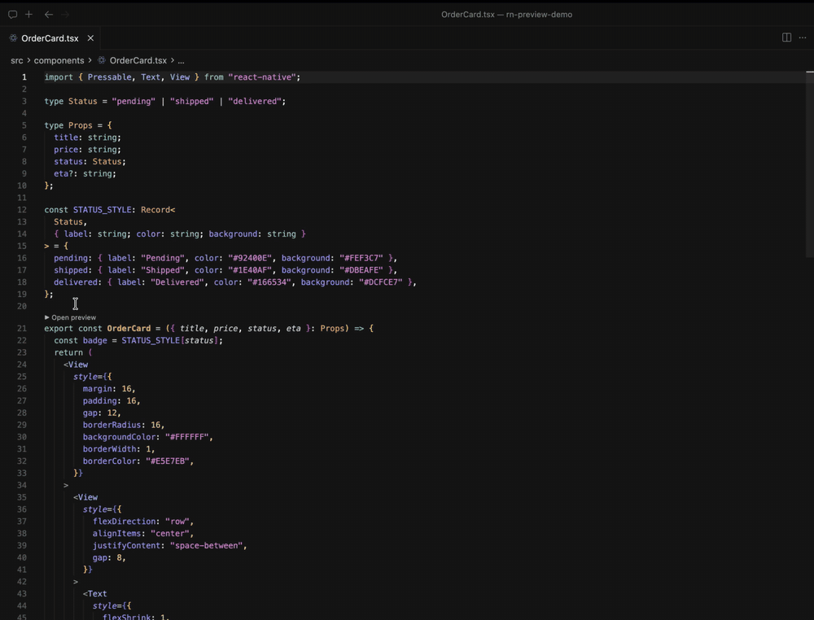
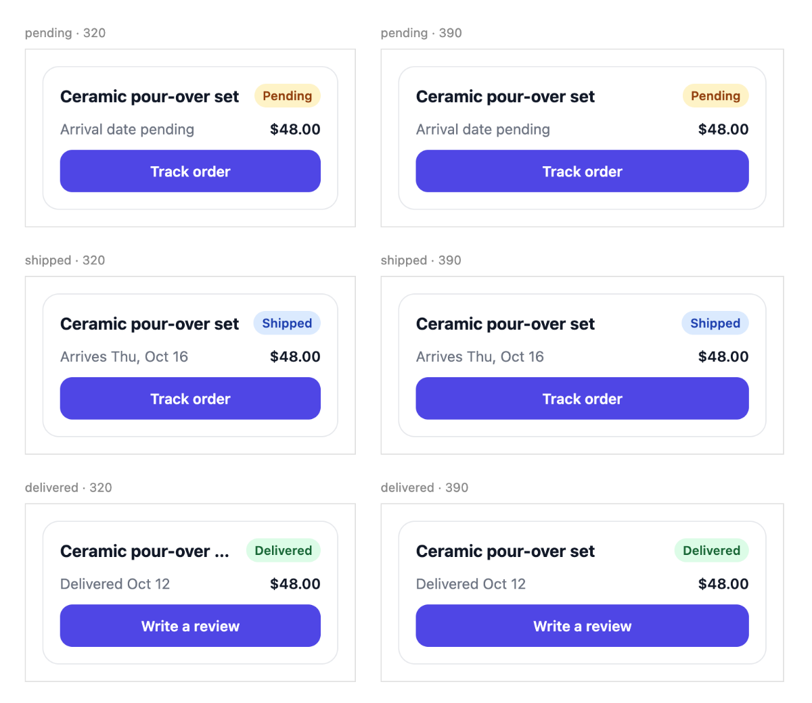

# RN Preview

React Native 컴포넌트를 앱을 빌드하지 않고 VS Code·Cursor 패널에서 봅니다.

_English: [README.md](README.md)_



그리는 일은 확장에 실린 [`rn-preview`](https://github.com/sean5940/rn-preview) 도구의 개발 서버가
`react-native-web` 으로 맡습니다. 이 확장은 그 서버를 띄우고 패널에 답니다. 화면을 캡처해 옮기지 않으므로 패널
안에서 지연 없이 조작됩니다.

선언한 변형·기기 폭·글자 배율·데이터 상태가 한 화면에 나란히 놓입니다. 실기기에서는 한 번에 하나만 볼 수 있는
것들입니다. 근사 렌더링이라 같게 그려지는 것과 다른 것은
[COMPATIBILITY](https://github.com/sean5940/rn-preview/blob/main/COMPATIBILITY.ko.md) 에 정리돼 있습니다.

에이전트에게 설치를 맡기려면 [docs/AGENT-SETUP.ko.md](docs/AGENT-SETUP.ko.md) 를 그대로 넘깁니다.

## 설치

- **VS Code**: [Visual Studio Marketplace](https://marketplace.visualstudio.com/items?itemName=sean5940.vscode-rn-preview)
  에서 설치하거나 `code --install-extension sean5940.vscode-rn-preview` 를 실행합니다.
- **Cursor 와 다른 VS Code 계열 편집기**: [Open VSX](https://open-vsx.org/extension/sean5940/vscode-rn-preview) 에서
  설치하거나 `cursor --install-extension sean5940.vscode-rn-preview` 를 실행합니다.
- **모든 편집기**: [Releases](https://github.com/sean5940/vscode-rn-preview/releases) 에서 `.vsix` 를 받아
  `Extensions: Install from VSIX...` 로 고릅니다.

## 준비물

- VS Code 1.96 이상 또는 Cursor.
- 편집기가 보는 `PATH` 에 Node.js 22 이상과 npm.
- 처음 프리뷰를 열 때 네트워크. 실려 있는 도구가 그때 의존성을 설치합니다(1~2분).
- `package.json` 이 `react-native` 를 의존하는 RN 프로젝트.

## 쓰기

1. RN 프로젝트를 엽니다. `react-native` 를 의존하는 폴더를 대상으로 잡습니다.
2. 컴포넌트 소스나 선언 파일에서 컴포넌트 선언 위의 `▶ Open preview` 를 누릅니다.

처음 열 때 도구를 확장 저장소에 한 번 설치합니다. 대상 프로젝트에는 선언 디렉토리 말고 아무것도 남지 않습니다.

선언이 없으면 그 자리에서 초안을 만들고 그것으로 그립니다. 패널 우측 상단에 버튼 두 개가 있습니다.

| 버튼        | 하는 일                                                                          |
| ----------- | -------------------------------------------------------------------------------- |
| `Refresh`   | 처음 화면으로 되돌립니다. 칸에서 바꾼 변형·상태를 버리고 다시 불러옵니다         |
| `Open code` | 지금 보고 있는 선언을 편집기 탭으로 엽니다. 돌아올 때는 그 탭의 `▶ Show preview` |

선언에 그릴 변형과 기기 폭을 적으면 모든 조합이 나란히 놓입니다.



선언 쓰는 법(변형·폭·글자 배율·응답 mock·상태)은
[rn-preview README](https://github.com/sean5940/rn-preview/blob/main/README.ko.md#선언-파일) 에 있습니다.

**항상 확장에 실린 도구를 씁니다.** 옆에 `rn-preview` 클론이 있어도 쓰지 않습니다. 기기마다 다른 코드가 돌면
배포되는 경로가 정작 검증되지 않기 때문입니다. 도구 자체를 고칠 때만 `rnPreview.projectPath` 로 자기 클론을
가리킵니다.

## 워크트리·브랜치

체크아웃마다 서버를 따로 잡습니다. 서버에 어느 체크아웃을 보는지 물어 같은 대상일 때만 재사용하고, 다르면 다음
포트로 비켜갑니다. 포트만 보고 재사용하면 **다른 브랜치를 그리는 서버를 그대로 써서** 화면은 뜨는데 내용이
다릅니다.

선언을 브랜치와 무관하게 공유하려면 `rnPreview.previewRoot` 에 절대경로를 넣습니다.

## 프로젝트별 설정

프로젝트마다 다른 것은 선언 디렉토리의 `rn-preview.config.json` 이 갖습니다. 대체 모듈처럼 그 프로젝트 사정을
아는 코드를 가리키기 때문에 확장 설정에 둘 수 없습니다.

```json
{
    "sourceRoot": "src",
    "nonRenderingPackages": ["react-native-vision-camera"],
    "moduleOverrides": { "src/config/index.ts": "_overrides/appConfig.ts" },
    "importRedirects": [
        {
            "importerUnder": "src/ui/foundation",
            "from": "src/ui/index.ts",
            "to": "src/ui/foundation/index.ts"
        }
    ]
}
```

| 필드                   | 뜻                                                                              |
| ---------------------- | ------------------------------------------------------------------------------- |
| `sourceRoot`           | 미리 볼 소스가 있는 디렉토리. 선언 경로가 이 아래 구조를 따릅니다. 기본값은 `.` |
| `nonRenderingPackages` | 화면을 안 그려 통째로 비울 패키지. `*` 를 쓸 수 있고, 기본값은 없습니다         |
| `moduleOverrides`      | 프리뷰에서만 다른 구현을 쓸 파일. 값은 선언 디렉토리 기준 경로입니다            |
| `rootProviders`        | 모든 칸에 씌울 Provider. 선언 디렉토리 기준 경로입니다                          |
| `importRedirects`      | 배럴 순환처럼 특정 디렉토리 안에서만 돌려야 하는 해석                           |

**주석을 쓸 수 없습니다.** `JSON.parse` 로 읽으므로 `//` 가 있으면 "프리뷰 설정을 읽지 못했습니다" 로 멈춥니다.
전체 필드는 rn-preview README
[「프로젝트별 설정」](https://github.com/sean5940/rn-preview/blob/main/README.ko.md#프로젝트별-설정)에, 그대로 쓸
수 있는 예시는
[docs/rn-preview.config.example.json](https://github.com/sean5940/rn-preview/blob/main/docs/rn-preview.config.example.json)
에 있습니다.

`nonRenderingPackages` 는 기본값이 없습니다. 안 적으면 analytics·푸시·권한 같은 네이티브 패키지를 스치는 화면이
통째로 안 뜹니다. 로그에 어느 모듈이 막혔는지 나옵니다.

## 명령

| 명령                                  | 하는 일                                                                 |
| ------------------------------------- | ----------------------------------------------------------------------- |
| `RN Preview: Open preview`            | 서버를 띄우고 패널을 엽니다. 선언 파일을 열어둔 채면 그 선언을 고릅니다 |
| `RN Preview: Open preview code`       | 지금 보고 있는 선언을 편집기 탭으로 엽니다                              |
| `RN Preview: Restart preview server`  | 서버를 끄고 다시 띄웁니다                                               |
| `RN Preview: Stop preview server`     | 서버와 패널을 닫습니다                                                  |
| `RN Preview: Show preview server log` | 개발 서버 출력을 봅니다                                                 |

제목줄 버튼이 안 보이면 Cursor 가 확장 아이콘을 접어둔 것입니다. 넘침 메뉴의 `Configure Icon Visibility` 에서
켭니다. 패널 안의 `Refresh`·`Open code` 버튼은 그 설정과 무관합니다.

## 설정

| 설정                       | 기본값     | 뜻                                                                     |
| -------------------------- | ---------- | ---------------------------------------------------------------------- |
| `rnPreview.projectRoot`    | (비움)     | 대상 RN 프로젝트. 비우면 `react-native` 를 의존하는 열린 폴더를 씁니다 |
| `rnPreview.previewRoot`    | `previews` | 선언 디렉토리. 프로젝트 기준 상대경로                                  |
| `rnPreview.projectPath`    | (비움)     | `rn-preview` 도구 경로. 비우면 확장에 실어둔 것을 씁니다               |
| `rnPreview.port`           | `5173`     | 개발 서버 기준 포트. 체크아웃마다 하나씩 잡습니다                      |
| `rnPreview.startTimeoutMs` | `60000`    | 서버가 뜨기를 기다리는 시간                                            |

## 아무것도 안 뜰 때

먼저 `RN Preview: Show preview server log` 를 엽니다.

- `npm install failed`: 첫 실행 설치가 npm 레지스트리에 닿지 못했습니다. 네트워크나 프록시를 확인합니다.
- `Not a source file under sourceRoot`: 그 파일이 `rn-preview.config.json` 의 `sourceRoot` 밖에 있습니다.
- 칸이 마운트되지 않음: 화면을 그리지 않는 패키지(analytics·푸시·권한)가 웹에서 불려 오류를 냈습니다. 로그에
  나온 이름을 `nonRenderingPackages` 에 넣습니다.
- 네이티브 뷰(지도·영상·카메라)가 크기만 맞는 빈 상자로 나옴: 정상입니다. `react-native-web` 에 대응 구현이 없어
  그 둘레의 레이아웃만 의미가 있습니다.

도구 쪽 진단은 rn-preview README
[「안 뜰 때」](https://github.com/sean5940/rn-preview/blob/main/README.ko.md#안-뜰-때) 에 있습니다.

## 기여

빌드·패키징과 도구 변경이 확장에 실리는 과정은 [CONTRIBUTING.ko.md](CONTRIBUTING.ko.md) 에 있습니다.
